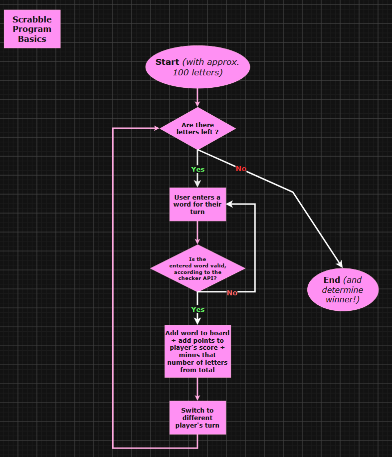

## Project Description

Easy, command-line version of a scrabble game

## The Problem

I love playing word games, but a lot of the physical copies are bulky and annoying to carry around. So, I figured I'd make a digital version that can be easily played without needing to carry around 100 tile pieces and a specific game board.

## How It Works

## Tech Stack

- **Language:** Java
- **External tools:** Scrabble word legality checker API
